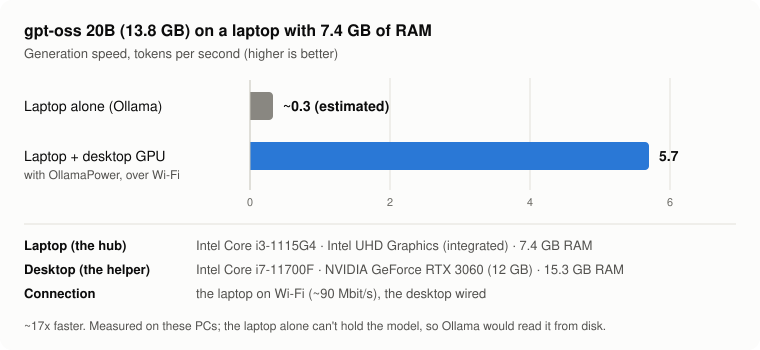
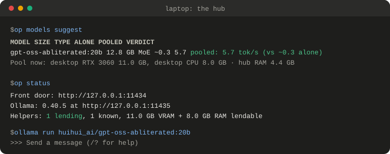
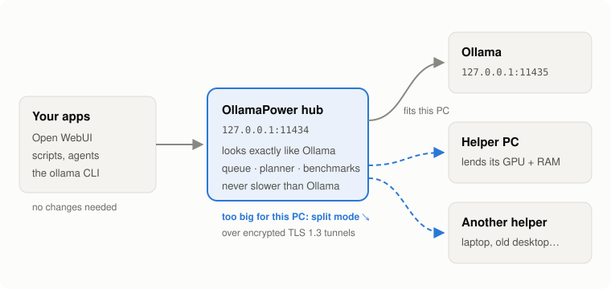

# OllamaPower

**Run models bigger than any PC you own, by pooling the PCs you already have.**

[](LICENSE)


Your laptop can't hold a 14 GB model. Your desktop's GPU can. OllamaPower puts
them together: the model's layers are spread over the PCs on your network, and
your apps keep talking to Ollama as if nothing changed.

<p align="center">
  
</p>

The test PCs: a **laptop** as the hub (Intel Core i3-1115G4, integrated Intel
UHD graphics, 7.4 GB RAM) on **Wi-Fi**, and a **desktop** as the helper (Intel
Core i7-11700F, NVIDIA GeForce RTX 3060 12 GB, 15.3 GB RAM), wired. The 5.7 tok/s
is measured on them; the "alone" figure is the hub's own estimate, because the
laptop can't hold the model (trying it crashed Ollama).
The speed-up needs a helper with a GPU: a CPU-only helper on Wi-Fi was slower
than a strong hub on its own (the hub noticed and kept Ollama). Details:
[`docs/BENCHMARKS.md`](docs/BENCHMARKS.md), [`docs/FIELD_TEST.md`](docs/FIELD_TEST.md).

## Quick start

```bash
# 0. On every PC: install it (needs Python 3.11+ and pipx; per OS below)
pipx install git+https://github.com/111yoav111/OllamaPower

# 1. On the PC where you use Ollama (the hub):
op init                     # creates its settings and a cluster token
op setup                    # Linux: moves Ollama aside, opens the firewall (asks first)
op token show               # the token your helpers will ask for
op hub                      # runs until you stop it: keep this terminal open

# 2. On every PC that should help (a helper):
op agent --hub 192.168.1.10 # the address `op hub` printed; paste the token when asked
```

Your apps keep using Ollama exactly as before, and models too big for the hub
now run across your PCs. Lost? Run `op` on its own: it tells you the next step.
On macOS and Windows, move Ollama by hand instead of `op setup` ([step 2](#2-the-hub-the-pc-with-ollama)).
`op` is also the 1Password CLI's name: if you use that, type `ollamapower`
instead (the same commands).

> **What this changes on your PC:** Ollama moves from port 11434 to 11435 (one
> settings file of OllamaPower's own), and the firewall lets your local network
> reach port 9000 on the hub and 9001 on helpers. `op uninstall` (and
> `op agent uninstall` on helpers) puts it all back. Nothing starts at boot, and
> OllamaPower never runs as root.

<p align="center">
  
</p>

## How it works

<p align="center">
  
</p>

The hub takes Ollama's usual address, so nothing else changes. A model that
fits your PC goes straight to Ollama. A model that doesn't is split: its layers
are spread over the hub and your helpers, which lend their GPU and RAM, and the
hub stitches the answer back together, streaming like Ollama does.

## Why it's nice

- **Drop-in.** The hub takes Ollama's address (`127.0.0.1:11434`); Open WebUI,
  scripts and the `ollama` CLI keep working unchanged. Ollama's and OpenAI's
  APIs work through split mode too: streaming, tool calls, JSON schemas,
  thinking (images not yet).
- **Never slower.** The hub benchmarks Ollama against split mode and uses split
  only when it measured at least 10 % faster, or when Ollama can't run the model
  at all. If split mode fails before an answer starts, Ollama answers instead.
- **Tells you what you can run.** `op models suggest` lists the models
  your PCs can run together and how fast, before you download anything.
- **Any PC counts.** GPUs, RAM, old desktops, laptops without a GPU, Wi-Fi.
  Mixture-of-experts models keep their experts in RAM and their hot parts on the
  GPUs.
- **Encrypted and pinned.** Helpers join with a cluster token, pin the hub's key,
  and split-mode traffic runs over mutually authenticated TLS 1.3.
- **The helper's owner decides.** Lending caps, a schedule, pause, and stepping
  back automatically when the owner starts a game or a render.
- **A terminal UI** for the hub and for every helper, a priority queue, and a
  full CLI.

## When does it help?

| Your situation | Does OllamaPower help? |
|---|---|
| The model already runs well on your PC | **No:** it stays on plain Ollama, untouched. |
| The model is too big for your PC, and another PC has a GPU | **Yes, the main case:** measured ~17x faster above. |
| The only helper is a weak PC without a GPU, on Wi-Fi | **Usually not:** the hub measures it and keeps Ollama when split is slower. |
| Huge models (Qwen3-235B, gpt-oss-120b) on several ordinary PCs | **What it's designed for**, but estimated only: not measured yet. |

**It never makes things slower:** a model that fits your GPU is never split, and
any other model is split only after the hub measured split mode at least 10 %
faster than Ollama (or Ollama can't run it at all). More cases and the reasons:
[`docs/REFERENCE.md`](docs/REFERENCE.md#when-pooling-helps).

## Setup, step by step

Two roles, one program:

| PC | Role | Needs |
|---|---|---|
| The PC where you already use Ollama | **Hub** (exactly one) | Python 3.11+, Ollama |
| Every other PC that should help | **Helper** (any number) | Python 3.11+ (no Ollama needed) |

All PCs must be on the same LAN. Two firewall ports: helpers reach the hub on
TCP **9000**, and the hub reaches each helper on TCP **9001** for split mode.

### 1. Install (on every PC)

OllamaPower is installed with [pipx](https://pipx.pypa.io), which keeps it in
its own environment and puts two commands on your PATH: `op`, and its long name
`ollamapower` (use that one if `op` is taken, e.g. by the 1Password CLI).

**Linux**

```bash
sudo apt install pipx          # Fedora: sudo dnf install pipx · Arch: sudo pacman -S python-pipx
pipx ensurepath                # then open a new terminal
pipx install git+https://github.com/111yoav111/OllamaPower
```

**macOS** (with [Homebrew](https://brew.sh))

```bash
brew install pipx git
pipx ensurepath                # then open a new terminal
pipx install git+https://github.com/111yoav111/OllamaPower
```

**Windows** (PowerShell; install [Python](https://www.python.org/downloads/)
with "Add python.exe to PATH" ticked, and [Git](https://git-scm.com/download/win))

```powershell
py -m pip install --user pipx
py -m pipx ensurepath          # then open a new terminal
pipx install git+https://github.com/111yoav111/OllamaPower
```

Check it worked with `op version`. To update later:
`pipx install --force git+https://github.com/111yoav111/OllamaPower`.

### 2. The Hub (the PC with Ollama)

```bash
op init       # creates the config dir, a cluster token, config.toml
op setup      # moves Ollama to port 11435 and opens port 9000 to your LAN
op doctor     # checks everything
op hub        # start it (terminal UI; --no-tui for plain logs)
```

OllamaPower takes Ollama's usual port (11434), so your apps keep working
unchanged, and Ollama moves next door to 11435. `setup` explains what it will
do, shows each command and asks first; `--print` only shows them.

**Is `sudo` safe here?** Only `setup` and `uninstall` use it, for a few fixed
commands they show you first; OllamaPower itself never runs as root, and Ollama's
own API stays private to this PC. The details: [`SECURITY.md`](SECURITY.md).

**Changed your mind?** `op uninstall` puts back exactly what `setup`
changed: Ollama on 11434, and only the firewall rules setup added (a rule you had
before stays). Remember that while the
hub isn't running, apps using port 11434 find no Ollama there.

`setup` handles Linux with Ollama as a systemd service (and ufw or firewalld).
On macOS and Windows, move Ollama by hand:

| OS | Move Ollama to 11435 |
|---|---|
| macOS | `launchctl setenv OLLAMA_HOST 127.0.0.1:11435`, then quit and reopen the Ollama app (lost at reboot; `doctor` shows how to keep it) |
| Windows | `setx OLLAMA_HOST 127.0.0.1:11435`, then quit Ollama from the tray icon and start it again |

and allow incoming TCP port **9000** when the firewall asks on the first run
(for **private** networks only).

When the hub starts, it prints the exact command for your helpers, with this
PC's address (`op agent --hub 192.168.1.10`); `op status` shows it too.

Finally, print the cluster token for the helpers:

```bash
op token show     # prints OLLAMAPOWER_TOKEN="..." - treat it like a password
```

### 3. Each Helper

Start it with the hub's LAN address, the one `op hub` printed:

```bash
op agent --hub 192.168.1.10
```

The first time, it asks for the **cluster token**: run `op token show` on the
hub and paste what it prints (it isn't shown while you paste, and it's saved
for next time, readable only by you). On a headless helper, put that line in
its `.env` instead (`~/.config/ollamapower/.env` on Linux,
`~/Library/Application Support/ollamapower/.env` on macOS,
`%APPDATA%\ollamapower\.env` on Windows) or set `OLLAMAPOWER_TOKEN`.

On first connect it shows the hub's **key fingerprint**: check it matches the
one in the hub's Overview tab (or `op status` on the hub) and
confirm. The helper appears on the hub's Nodes tab. It downloads its
llama.cpp build once (about 30 MB) and then waits to be used.

The hub connects to the helper on TCP port **9001** to run a model split across
the PCs. On Linux, `op agent setup` opens it to your local network
(asking first; `op agent uninstall` closes it again). Windows and macOS
ask on the first split run: allow it for **private** networks. Another port:
`relay_port` in `agent.toml`.

A helper with **no GPU** lends only after its owner allows it:

```bash
op agent rules --allow-cpu
```

### 4. Use it

Nothing changes for your apps: Open WebUI, scripts and the `ollama` CLI keep
using `http://127.0.0.1:11434`. To see what your PCs can now run together:

```bash
op models suggest
```

A model too big for the hub alone is split across the PCs on its first
request. `op status` on the hub shows what is happening.

### Troubleshooting

| Problem | Fix |
|---|---|
| `op: command not found` | Open a new terminal after `pipx ensurepath`. |
| Helper says the token is missing or wrong | Run `op agent` in a terminal: it asks for the token (paste what `op token show` prints on the hub). Headless: put that line in the helper's `.env`. |
| Helper can't reach the hub | Is `op hub` running? Is port 9000 open in the hub's firewall (`op setup`)? Are both PCs on the same network? Try `ping <hub address>` from the helper. |
| Helper refuses: the hub's key changed | Only if you re-created the hub's key yourself: `op agent forget-hub` on the helper, then connect again. |
| A model you pulled doesn't show up | It went to another Ollama: don't run `ollama serve` yourself (it ignores the service's settings, e.g. `OLLAMA_MODELS`). With the hub running, a plain `ollama pull <model>` reaches the right Ollama. |
| Split mode fails with "couldn't reach <helper> ... is its firewall blocking it?" | Allow incoming TCP 9001 (`relay_port`) in that helper's firewall. |
| "Split mode can't run it right now" (503) | The model is too big for the hub and the helpers lack room: close what uses their GPU (e.g. a model loaded in their own Ollama) or add a helper. `op models suggest` shows what's missing. |
| Hub says port 11434 is in use | Ollama still listens there: run `op setup` (or move it by hand, step 2). |
| Apps find no Ollama / no models | The hub isn't running (Ollama is on 11435): start `op hub`, or `op uninstall` to put Ollama back on 11434. Don't start `ollama serve` yourself: it's a second, empty Ollama. |
| Anything else | `op doctor` on the hub, `op logs` for the event log. |

## More

Everything else - the hub's terminal UI and its keys, every command, what a
helper's owner controls, tunnel modes, how the hub decides when to split, and
all the settings - is in [`docs/REFERENCE.md`](docs/REFERENCE.md). Security:
[`SECURITY.md`](SECURITY.md). Real measurements: [`docs/BENCHMARKS.md`](docs/BENCHMARKS.md).

## Credits

OllamaPower is the continuation of
[DCP - Dynamic Compute Power](https://github.com/111yoav111/Dynamic-Compute-Power),
whose encrypted protocol, token auth and priority queue it reuses
(MIT). Split mode is built on [llama.cpp](https://github.com/ggml-org/llama.cpp)'s
RPC backend; models come from your local [Ollama](https://ollama.com).

## License

MIT, see [LICENSE](LICENSE).
